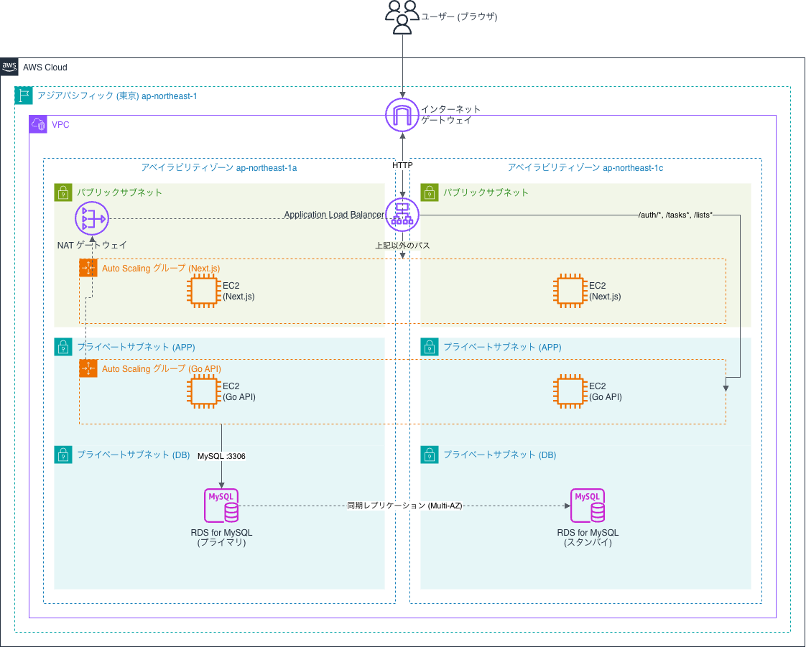

# Step7 課題提出: インフラ1(構成図)

Step7の課題ページ([final-challenge/app/step7](https://devopscamp.reheartcloud.com/final-challenge/app/step7))に沿って、Step3のバックエンド(Go)とStep6のフロントエンド(Next.js)をAWS上で動かすためのインフラ構成を設計し、構成図にまとめた。実際の構築はStep8で行う。

## 1. 概要

### 構成の特徴

- 東京リージョン(ap-northeast-1)の2つのアベイラビリティゾーン(1a・1c)にまたがる冗長構成
- フロントエンド(Next.js)・バックエンド(Go API)をそれぞれ別のAuto ScalingグループのEC2で動かし、1台のALBがURLのパスで振り分ける(`/auth/*`・`/tasks*`・`/lists*`はGo API、それ以外はNext.js)
- データベースはRDS for MySQLをMulti-AZ構成にし、DB用のプライベートサブネットに配置する
- 使用するサービスは、Step7の必須講座で扱うサービスの範囲内に留める方針とした

### 採用サービス

| サービス | 役割 |
|---|---|
| VPC | アプリケーション全体を置く専用ネットワーク。各AZに、パブリックサブネット(ALB・Next.js用EC2)、APP用プライベートサブネット(Go API用EC2)、DB用プライベートサブネット(RDS)の3つを持つ |
| EC2 | Next.js(`next start`)とGo APIを動かすサーバー |
| ELB(Application Load Balancer) | インターネットからのリクエストを受け、パスに応じてNext.js用・Go API用のEC2に振り分ける。ヘルスチェックで応答しないEC2を振り分け対象から外す |
| Auto Scaling | Next.js用・Go API用それぞれで、EC2の台数を負荷に応じて自動で増減し、壊れたEC2を自動で作り直す |
| RDS for MySQL | タスク・ユーザー・リストのデータを保存する。Multi-AZで別AZにスタンバイを持つ |
| NATゲートウェイ | APP用プライベートサブネットのEC2が外へ出るための出口。AZ-aのパブリックサブネットに1つ置く |

## 2. インフラ構成図

構成図の元データは[docs/infra/architecture.drawio](../infra/architecture.drawio)(draw.io形式)で管理し、VS Codeのdraw.io拡張機能(`Draw.io: Export To...`)でPNGに書き出している。

### 主なパラメータ

| 項目 | 設定 |
|---|---|
| リージョン / AZ | ap-northeast-1 / 1a・1c |
| サブネット配置 | ALB・Next.js用EC2・NATゲートウェイ：パブリック / Go API用EC2：APP用プライベート / RDS：DB用プライベート |
| Auto Scalingグループ(Next.js用・Go API用で共通) | 最小2台・最大4台、希望台数の初期値2台 |
| スケーリングポリシー | ターゲット追跡、平均CPU使用率70% |
| ヘルスチェック | ALBのヘルスチェックを使い、応答しないEC2は自動で作り直す |
| RDS | MySQL、Multi-AZ(同期レプリケーションでスタンバイを持つ) |
| 通信 | ブラウザ〜ALB間はHTTP(HTTPS化は今回見送り) |

### 月額費用の概算

AWS Pricing Calculator（東京リージョン、2026年10月時点）で見積もった結果は次のとおり。

| 項目 | 金額 |
|---|---|
| 初期費用 | 0 USD |
| 月額 | 214.87 USD（1ドル150円で約32,000円） |
| 12か月の合計 | 2,578.44 USD |

見積もりの前提は、次のとおり。
- EC2（t3.micro）4台（Next.js用2台・Go API用2台、Auto Scalingの最小台数）
- ALB 1つ（常時稼働）
- NATゲートウェイ 1つ（AZ-a）
- RDS for MySQL（db.t3.micro、Multi-AZ、ストレージ20GB）
- パブリックIPv4アドレス 5つ（Next.jsのEC2 2台、ALB 2つ、NAT 1つ）
- すべて24時間稼働。Auto Scalingで台数が増えた場合の費用は含まない

Step8で動作確認したあとは削除する想定のため、実際にかかる費用は見積もりより小さくなる。

## 3. 選定理由

<!-- 各サービスについて「なぜそれを選んだか」を自分の言葉で書く。下の問いはヒント(全部に答える必要はない) -->

### EC2(フロントエンドもEC2で配信する)

フロントエンドはサーバー側の処理を使っていないため、S3 + CloudFrontで配信する方が費用も手間も少ない。それでもEC2を選んだのは、必須講座で学んだVPC・EC2・ALB・Auto Scalingの構成を、バックエンドと同じ仕組みでフロントエンドにも適用するためである。学んだ構成を実際のアプリに反映させることを優先した。

### Next.js用とGo API用でEC2群を分ける

Next.js 用と Go API 用で EC2 群を分けた。フロントと API は、URL と JSON の形だけで結びついている（疎結合）。そのため、片方の台数や更新を、もう片方に影響させずに行える。また、API の機能（認証・タスク・リスト）は Go 側にまとまっているため、API の変更は API 側の EC2 群だけで完結する（高凝集）。

### ELB(ALB)とパスによる振り分け

ロードバランサーがないと、利用者はEC2 1台のアドレスに直接つなぐことになる。そのEC2が止まると、アプリ全体が止まってしまう。ALBを挟めば、利用者は常に1つの入口にアクセスすればよく、裏のEC2が入れ替わっても気づかれない。ALBのヘルスチェックが応答しないEC2を振り分け対象から外すため、Auto Scalingが新しいEC2を作るまでの間も、残りのEC2に振り分けが続く。台数が増えたときも、ALBが新しいEC2を振り分け先に自動で加える。

パスで振り分けると、ブラウザから見たフロントとAPIが同じURL（ALBのアドレス）になる。そのため、フロントからAPIへの接続先（`NEXT_PUBLIC_API_BASE_URL`）はALBのアドレス1つで済む。本番では、フロントとAPIが同じ接続元として扱われるため、CORSの設定が不要になる。開発時にフロントとAPIを別のポートで動かすときは、引き続きCORSが必要である。

ALBを選んだのは、URLのパスでNext.jsとGo APIを振り分け、フロントとAPIを同じURLにまとめるためである。NLBはIPアドレスとポート番号しか見られないため、パスで振り分けられず、今回の構成には合わない。

### Auto Scaling(最小2・最大4・CPU 70%)

最小を2にしたのは、2つのAZにそれぞれ1台ずつ置くためである。最小1だと、そのEC2が止まった瞬間にアプリが応答しなくなり、新しいEC2が起動して動き出すまで数分かかる。最小2なら、片方のAZが止まっても、もう片方のEC2が応答を続ける。

最大4は、費用の上限を決めるためである。個人用の利用で2台を超える負荷は考えにくい。それでも、設定の誤りや攻撃で台数が際限なく増えると費用が膨らむため、上限を設けて、そのリスクを小さくした。

目標値を70%にしたのは、新しいEC2が起動するまでの数分間を、残りの30%の余力でしのぐためである。目標を100%近くにすると余力がなくなり、台数が増えるころには利用者が待たされる。目標を50%にすると早めに増えて安全になるが、台数が増えやすく、費用も増える。70%は、安全性と費用のバランスを取った値である。

### VPCとサブネットの分け方

講座のハンズオンと同じく、利用者が直接届く層（Next.js）はパブリックサブネットに、直接届く必要のない層（Go API・DB）はプライベートサブネットに置いた。

Go APIのEC2はAPP用のプライベートサブネットに置いた。インターネットから直接届かない場所にすることで、APIを守るためである。APIへの通信は、ALBのセキュリティグループからの通信だけを許可する。Go APIのEC2は、OSの更新やパッケージの取得のために外へ出る必要がある。そのため講座と同じく、パブリックサブネット（AZ-a）にNATゲートウェイを1つ置き、APP用プライベートサブネットからの外向き通信をそこへ向けた。NATゲートウェイは外からの接続を受け付けないため、APIが外から直接届くことはない。

NATゲートウェイを置くのは1つのAZだけにした。コストを抑えるためである。AZ-aが止まると外向き通信は止まるが、利用者のリクエストはALBからEC2へ届き、DBはVPC内で通信するため、サービス自体は止まらない。高可用性を求めるなら、各AZにNATゲートウェイを置く（講座でもコストとのトレードオフとして説明されている）。

Next.jsのEC2はパブリックサブネットに置いた。利用者のブラウザが直接アクセスする層であり、講座のWebサーバと同じ扱いにするためである。インターネットから届くが、セキュリティグループでALBからの通信だけを許可し、直接のアクセスを防ぐ。

RDSをプライベートサブネットに置いたのは、データベースをインターネットから一切届かない場所に置くためである。RDSへの通信は、Go API のEC2のセキュリティグループからの通信だけを許可する。

### RDS for MySQL(Multi-AZ)

EC2に自分でMySQLを入れる場合は、バックアップ、OSやMySQLのアップデート、障害時の切り替えを自分で行う必要がある。RDSでは、これらをAWSが管理してくれる。特に、自動バックアップと障害時の切り替えが標準で用意されている点が大きい。

Multi-AZにしたのは、1つのAZが障害で止まってもデータベースを使い続けるためである。別のAZにあるスタンバイには、同じデータが常に書き込まれている。プライマリのAZに障害が起きると、スタンバイが自動で昇格し、接続先のアドレスが切り替わる。アプリ側は接続先を変えずに済む。ただし切り替えの間は、一時的にDBへの接続が切れるため、完全に止まらないわけではない。

### 検討して見送ったもの

| 案 | 見送った理由 |
|---|---|
| フロントエンドをS3 + CloudFrontで配信 | 費用と手間は最も少ないが、任意講座の範囲になる。学習目的として、必須講座の構成で揃えることを優先した |
| フロントエンドをAmplify Hostingで配信 | 中で何が起きているかが見えにくく、学習の目的に合わない。また任意講座の範囲になる |
| Next.jsとGoを同じEC2に同居 | 片方の負荷や不具合が両方に影響する。詳細は「Next.js用とGo API用でEC2群を分ける」を参照 |
| Next.jsのEC2もプライベートサブネットに置く | 講座のWebサーバと同じく、利用者が直接届く層はパブリックに置く形に揃えた。プライベートにすればさらに守りは固くなるが、講座の形から外れる |
| Route 53 + ACMによるHTTPS化 | 独自ドメインの取得費用がかかり、Route 53・ACMは任意講座の範囲になる。今回は見送り、デメリットとして明記する |

## 4. 構成のメリット・デメリット

<!-- メンタリング報告「提出課題の説明」用。構成図をもとに説明できるように整理する -->

### メリット

- AZ 1つが止まっても、もう片方のAZで応答を続けられる。
- Next.jsとGoの台数を、それぞれの負荷に応じて個別に増減できる。
- フロントとAPIが同じURLになり、接続先の設定が単純になる。
- Go APIとDBはインターネットから直接届かない場所に置かれ、外からの攻撃を受ける面が小さい。
- データベースのバックアップや障害時の切り替えを、AWSに任せられる。

### デメリット(リスク)

- ブラウザとALBの間がHTTPのため、ログイン時のパスワードやJWTが暗号化されずに流れる。
- Next.jsのEC2がパブリックサブネットにあるため、セキュリティグループの設定を誤るとインターネットに直接さらされる。
- 静的ファイルを配るだけのフロントエンドにもEC2を最低2台動かすため、費用が増える。

## 5. まとめ

### 検討したこと

フロントエンドの配信方法（S3 + CloudFront、Amplify、EC2）、EC2の分け方、サブネットの分け方、データベースの可用性の4点を検討した。構成ごとに月額費用も試算し、どこに費用がかかるかを確認した。

### 工夫したこと

ALBのパス振り分けで、フロントとAPIを同じURLにまとめた。また、費用の内訳を表にして、どの設計にいくら費用がかかるかが見えるようにした。

### 学んだこと

可用性は、複数のAZに置くことと、ヘルスチェックで壊れたものを外すこと、Auto Scalingで作り直すことを組み合わせて成り立つ。どれか1つでも欠けると、障害時に止まってしまう。また、費用の大部分は、可用性のための冗長化（RDSのMulti-AZ、NATゲートウェイなど）から生じていた。

Step6では、手元に残っていたファイルの影響でビルドが通っていた。まっさらな環境で確認すると型チェックが失敗したため、手元の環境だけで通ることを確かめるのでは不十分だと学んだ。

## 6. 小山さんへの質問

### フロントエンドとAPIを同じURLにまとめる設計は妥当か

- **現在の判断**：ALBのパスで振り分け、`/auth/*`・`/tasks*`・`/lists*`をGo API、それ以外をNext.jsに振り分けている。フロントとAPIを同じURL（ALBのアドレス）にまとめた。理由は、本番でCORSの設定が不要になり、API接続先を1つにできるため。独自ドメインとDNSの設定、HTTPS化を今回の範囲に入れていないため、同じURLにまとめた。
- **検討した別案**：サブドメインで分ける（例：`app.` と `api.` のドメイン）。この場合はCORSの設定が必要になる。- **暫定的な結論**：個人用で規模が小さく、フロントとAPIを別々のチームで運用することもないため、同じURLにまとめる方が適していると考えている。
- **質問**：小山さんの観点から見て、この判断は講座の内容に照らして妥当か。また、APIのパスが増えた場合や、チームで分担するようになった場合に、サブドメインへ分ける判断に変わるべきか、ご意見を伺いたい。

### ヘルスチェックの設計をStep8でどう進めるか

- **現在の設計**：ALBのヘルスチェックで、応答しないEC2を振り分け対象から外す。ヘルスチェックのパスとしきい値は今回の課題の対象外とし、Step8の構築で決める前提にしている。
- **問題**：Go APIには、未ログインで`200`を返すURLがない。`GET /tasks`は未ログインだと`401`を返すため、ヘルスチェックが失敗する。すべてのGo API用EC2が「応答しない」と判定されると、振り分け先がなくなり、ログインもタスク操作もできなくなる。Next.jsは`/`で問題ないと考えている。
- **検討している案**：
  - A：Go APIに、認証なしで`200`を返す`GET /health`を追加する。シンプルで、一般的に使われている方法。
  - B：ヘルスチェックのパスを`/auth/login`にする。ただし、`POST`しか受け付けないため、応答の種類を曖昧に許容する必要があり、おすすめしない。
- **質問**：Step8でAの`/health`を追加し、ヘルスチェックに使う方針でよいか。また、Step8の構築でヘルスチェックのパスやしきい値をどこまで決めるのが想定されているか。Next.jsのヘルスチェックを`/`にしてよいか。
