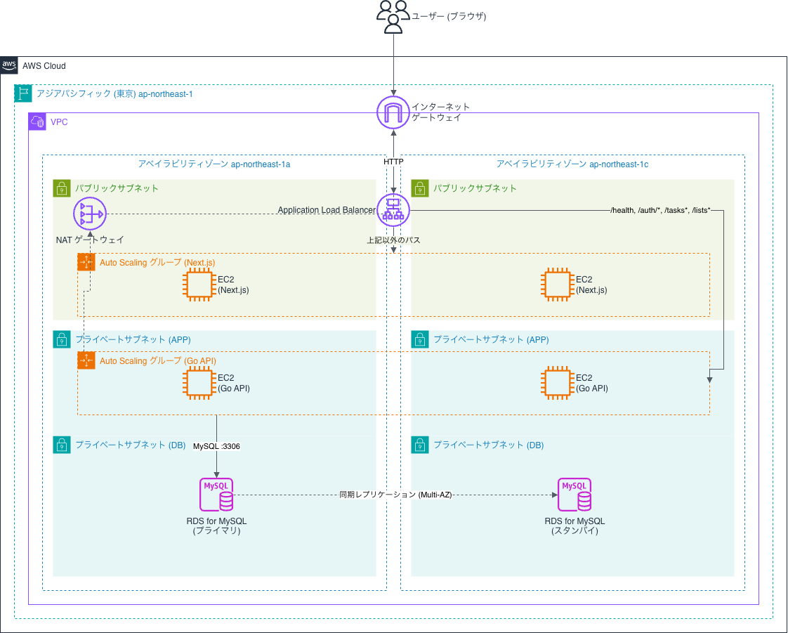

# Step8 課題提出: インフラ2(構築)

Step8の課題ページ([final-challenge/app/step8](https://devopscamp.reheartcloud.com/final-challenge/app/step8))に沿って、Step7で設計したインフラをAWS上に構築し、Step3のバックエンド(Go)とStep6のフロントエンド(Next.js)を動かす。

## 1. 概要

<!-- 構築したインフラの特徴と採用サービス。Step7から変更した点があれば、その内容と理由を書く -->

### 構成の特徴

- 東京リージョン(ap-northeast-1)の2つのアベイラビリティゾーン(1a・1c)にまたがる冗長構成。NATゲートウェイだけは、費用を抑えるため1aに1つ置いた
- 1台のALBがURLのパスで振り分ける。`/health`・`/auth/*`・`/tasks*`・`/lists*`はGo API、それ以外はNext.jsに送る。フロントとAPIが同じアドレスになるため、本番ではCORSの設定が要らない
- Next.js用・Go API用で別々のAuto Scalingグループを持ち、それぞれ最小2台・最大4台、平均CPU使用率70%を目標に台数を増減する
- EC2は起動時のユーザーデータでGitHubからコードを取得してビルドし、systemdで起動する。Auto ScalingがEC2を作り直しても、同じ状態で立ち上がる
- データベースはRDS for MySQL 8.4をMulti-AZ構成にし、DB用のプライベートサブネットに置いた
- DBのパスワードと`JWT_SECRET`はParameter Storeに暗号化して保存し、Go API用EC2のIAMロールだけが読める。EC2への接続はSession Managerを使い、SSHの22番ポートはどこにも開けていない

### 採用サービス

| サービス | 役割 |
|---|---|
| VPC | アプリケーション全体を置く専用ネットワーク。各AZに、パブリックサブネット(ALB・Next.js用EC2・NAT)、APP用プライベートサブネット(Go API用EC2)、DB用プライベートサブネット(RDS)を持つ |
| EC2 | Next.js(`next start`、ポート3000)とGo API(ポート8080)を動かすサーバー。Amazon Linux 2023、t3.micro |
| ELB(Application Load Balancer) | インターネットからのリクエストを受け、パスでNext.js用・Go API用のEC2に振り分ける。ヘルスチェックで応答しないEC2を振り分け対象から外す |
| Auto Scaling | Next.js用・Go API用それぞれで、EC2の台数を負荷に応じて増減し、ヘルスチェックに失敗したEC2を作り直す |
| RDS for MySQL | タスク・ユーザー・リストのデータを保存する。Multi-AZで別のAZにスタンバイを持つ |
| NATゲートウェイ | APP用プライベートサブネットのEC2が、GitHubからのコード取得やGoのダウンロードのために外へ出る出口 |
| Systems Manager(Step8で追加) | Parameter Storeで秘密情報を保存し、Session ManagerでEC2に接続する |
| IAM(Step8で追加) | EC2に付けるロール。Session Managerでの接続と、Go API用EC2からのParameter Storeの読み取りを許可する |

### Step7からの変更点

| 変更点 | 理由 |
|---|---|
| ALBのGo API向けルールに`/health`を追加 | 判定基準の「インターネットからcurlで`/health`にアクセスする」ため。ルールがないと`/health`はNext.jsへ振り分けられ、404になる(ALBのヘルスチェック自体はEC2へ直接届くため、ルールがなくても動く) |
| Session Manager・IAMロールを追加 | プライベートサブネットのGo API用EC2に、SSHのポートを開けずに入るため(小山さんのTips)。ユーザーデータが失敗したときのログ確認に使う |
| 秘密情報をParameter Storeで管理 | DBのパスワードと`JWT_SECRET`を起動テンプレートに直接書かないため(小山さんのTips)。Go API用EC2のIAMロールだけが読める |
| ターゲットのポートをGo API 8080・Next.js 3000にした | アプリの待ち受けポートに合わせた(講座は80番) |

### 構築の方針

- **アプリの配置**：起動テンプレートのユーザーデータ(EC2の初回起動時に自動で実行されるスクリプト)で、GitHubからコードを取得してビルドし、systemdで起動する。講座のハンズオンと同じ方式。スクリプトは[scripts/userdata-api.sh](../../scripts/userdata-api.sh)・[scripts/userdata-web.sh](../../scripts/userdata-web.sh)
- **テーブル作成**：Go API用EC2のユーザーデータで`schema.sql`を実行する。`CREATE TABLE IF NOT EXISTS`のため、2台目以降が実行しても既存のデータは消えない
- **フロントからAPIへの接続先**：`NEXT_PUBLIC_API_BASE_URL`を空にしてビルドし、相対パス(`/tasks`など)でリクエストさせる。ALBを作り直してアドレスが変わっても、ビルドし直さずに済む
- **費用**：月額214.87 USDは1時間あたり約0.29 USD(約44円)。ALB・NATゲートウェイは停止できず、存在する間は課金されるため、動作確認とスクリーンショットの取得が終わったらすべて削除する。デモをする場合は、下の「付録」の手順で作り直す

### 小山さんからの回答（Step7の質問への回答、2026/10/24）

提出物は必須要件をすべて満たしており、対応が必要な箇所はないという評価だった。質問への回答は次のとおり。

#### フロントエンドとAPIを同じURLにまとめる設計

- **回答**：現在の規模では妥当。本番ではCORSの設定は不要で、フロントからAPIへの接続先（`NEXT_PUBLIC_API_BASE_URL`）も1つでよい。
- **サブドメインに分ける判断になる条件**（小山さんの挙げた例）：
  - フロントとAPIで、証明書・DNS・WAFの設定を別々に変える必要が出たとき
  - APIのパスが、Next.jsのルート（例：`/users`）と衝突しそうなとき
  - フロントとAPIを別のチームが別々にデプロイ・レビューするようになったとき
  - APIだけにレート制限や認証を強くかけたいとき
  - フロントとAPIで、CDNのキャッシュ方針を変えたいとき

#### ヘルスチェック

- **回答**：`/health`（認証なしで`200`を返す）を採用する。`/auth/login`は使わない。Go APIに`/health`を追加するのはこのStep8の作業とする。
- **Step8で設定する値**（小山さんの提案。動かしながら調整する）：

| 項目 | 値 |
|---|---|
| パス | `/health`（Go API） |
| 間隔 | 30秒 |
| タイムアウト | 5秒 |
| 正常と判定する回数 | 2回連続 |
| 異常と判定する回数 | 3回連続 |

- **DBの疎通を`/health`に含めるか**：最初は、サーバーが起動しているかだけを確認する。DBの疎通を含めると、RDSのMulti-AZ切り替え（1〜2分）の間に全台が異常と判定されるおそれがある。含める場合は、切り替え時間より長くなるようにしきい値を見直す。
- **Next.jsのヘルスチェック**：`/`のままでよい。小山さんの提案では、両方を同じ形にそろえるため`/api/health`を追加する案も挙げられている。ただしStep6のビルドログでは`/`は静的生成（`○`）になっており、`/`を使っても問題はない。Step8では`/`を使い、問題なく`healthy`になった。

#### Step8で検討するTips（任意）

- **秘密情報の管理**：DBのパスワードなどをParameter StoreのSecureStringに保存し、EC2のIAMロールで読み取る。EC2の起動設定（User Data）に秘密情報を書かない。→ **実装した**。DBのパスワードと`JWT_SECRET`を保存し、Go API用EC2のIAMロールだけが読める。
- **EC2への接続**：SSHを開けず、Session Manager（`AmazonSSMManagedInstanceCore`）で接続する。→ **実装した**。Go API用・Next.js用の両方のIAMロールに付けた。
- **ログの保存**：ALBのアクセスログをS3に保存し、Athenaで検索する。保存期間は30日とする案。→ **見送った**。動作確認のあとすぐに環境を削除するため。

## 2. インフラ構成図(構築後)



Step7の構成図([docs/infra/architecture.drawio](../infra/architecture.drawio))を、構築後の最終構成に更新した。図の上での変更は、ALBからGo APIへの振り分けに`/health`を加えた点である。

## 3. 動作確認

### 3-1. バックエンドのヘルスチェック(curl)

インターネットからALB経由で`GET /health`にアクセスし、Go APIから`200 OK`が返ることを確認した(2026-11-05)。

```sh
curl -i http://smatsumae-devops-camp-alb-531847488.ap-northeast-1.elb.amazonaws.com/health
```

```
HTTP/1.1 200 OK
Date: Wed, 04 Nov 2026 16:11:51 GMT
Content-Type: application/json
Content-Length: 16
Connection: keep-alive

{"status":"ok"}
```

この応答から、ALBのパス振り分け(`/health`がGo APIに届く)、NATゲートウェイ経由の外向き通信(GitHubからのコード取得・Goのダウンロード)、IAMロールによるParameter Storeの読み取り、RDSへの接続(APIは起動時にDBへの接続を確認し、失敗すると起動しない)が動いていることも確認できる。

### 3-2. フロントエンドの動作確認(ブラウザ)

ブラウザでALBのアドレスを開き、新規登録・ログイン・タスクの作成・タスクの更新ができることを確認した。ページを再読み込みしても作成したタスクが残っており、データがRDSに保存されていることも確認した。

スクリーンショットは、メンタリング時にGoogle Docsで提示する。

### 3-3. 設定画面での確認

Step7の設計どおりに構成されていることを、AWSコンソールの設定画面で確認した。スクリーンショットは、メンタリング時にGoogle Docsで提示する。

| 対象 | 確認した画面 | 確認した内容 |
|---|---|---|
| EC2・Auto Scaling | Auto Scalingグループの一覧、EC2の一覧 | Next.js用・Go API用の2グループが、最小2・希望2・最大4で、EC2が1a・1cに1台ずつ動いている |
| ALB | リスナーのルール、ターゲットグループの「ターゲット」タブ | `/health`・`/auth/*`・`/tasks*`・`/lists*`がGo API、それ以外がNext.jsに転送され、4台とも`healthy` |
| VPC | リソースマップ、APP用ルートテーブルのルート | パブリック・APP用・DB用のサブネットがAZごとにあり、APP用だけが`0.0.0.0/0`をNATゲートウェイへ向けている |
| セキュリティグループ | 4つのグループのインバウンドルール | ALBだけがインターネットから届き、その先は1つ手前のグループからの通信だけを許可している |
| RDS | 「設定」タブ、「接続とセキュリティ」タブ | マルチAZが有効で、パブリックアクセスは無効 |

## 4. まとめ

### 苦労したこと

- **コンソールだけで構築したこと**：講座の進め方にならい、AWS CLIなどは使わず、すべてAWSコンソールの画面から構築した。サービスごとに画面を移りながら、同じような設定を何度も入力する必要があった。作り直すときに迷わないよう、入力した値を付録の手順書に残した
- **各サービスの役割を調べながら進めたこと**：それぞれのサービスがどういうものか、まだ十分に身についておらず、設定項目が出てくるたびに調べる必要があった。たとえばEC2だけでも、`smatsumae-devops-camp-web-template`(Next.js用)と`smatsumae-devops-camp-api-template`(Go API用)の2つがあり、置くサブネット(パブリックかプライベートか)、セキュリティグループ、IAMロール、ユーザーデータがそれぞれ違った。どのサービスがどこに置かれ、どのサービスとつながっているのかを意識しながら設定する必要があり、大変だった

### 構築した構成のデメリット・リスク

Step7で挙げたデメリット(HTTPのままであること、Next.jsのEC2がパブリックサブネットにあること、フロントにもEC2を2台使う費用)は、そのまま残っている。そのうえで、実際に構築して分かったものを挙げる。

| デメリット・リスク | 起きること | 対策の案 |
|---|---|---|
| NATゲートウェイが1aにしかない | 1aが止まると、1cのGo API用EC2も外へ出られなくなる。動いているEC2は応答を続けるが、新しく起動したEC2はコードやGoを取得できず、起動に失敗する | 1cにもNATゲートウェイを置く(NATゲートウェイと固定IPアドレスの分で、月額が約50 USD増える) |
| EC2の起動時にビルドする | 新しいEC2が使えるようになるまで、Next.jsで10分以上かかる。負荷が急に増えても、すぐには台数を増やせない。GitHubやGoの配布サイトが止まっていると起動できない | ビルド済みのものを用意しておき、起動時はそれを動かすだけにする(Step10のコンテナ化で解消する見込み) |
| 起動した時点の`main`ブランチを取得する | EC2ごとに起動した時刻が違うため、途中で`main`を更新すると、新旧のコードが混ざって動くことがある | 取得するバージョン(タグなど)を固定する。Step11のCI/CDで、全台を同じバージョンに入れ替える |
| テーブルの変更を自動で反映できない | `schema.sql`は`CREATE TABLE IF NOT EXISTS`のため、すでにあるテーブルに列を追加するような変更は反映されない | マイグレーション(DBの変更を順番に適用する仕組み)を導入する |
| `/health`がDBの疎通を確認しない | DBに接続できなくなっても、ALBはGo API用EC2を正常と判定してリクエストを送り続け、利用者にはエラーが返る | 小山さんの回答のとおり、Multi-AZの切り替え時間を考慮したうえで、DBの確認を含めるかを判断する |
| 手作業で構築している | 作り直すたびに、コンソールで同じ設定を手で入力する必要があり、時間がかかり、設定を誤るおそれがある。費用のため常時は動かせず、デモのたびに作り直しが必要になる | 構築手順をコード化する(CloudFormationなど)。現時点では、付録の手順書で再現できるようにした |

## 付録: 構築手順と設定値

削除したあとに作り直せるよう、手順と設定値を残す。リージョンはすべて東京(ap-northeast-1)。実際に入力した値が下と違ったら、この表を直す。

### 0. 事前準備

- ユーザーデータはGitHubの`main`ブランチからコードを取得するため、`/health`とスクリプトを含むコミットを先にpushしておく
- DBのパスワードは英数字だけにする(記号が入ると、接続文字列の区切りと混ざるおそれがある)
- `JWT_SECRET`はターミナルで`openssl rand -hex 32`を実行して作る(ランダムな64文字を表示する)
- AWSアカウントはほかの参加者と共有しているため、アカウント全体で名前が重複できないリソース(RDS・IAMロール・Parameter Store・ALB・ターゲットグループ・起動テンプレート・Auto Scalingグループ)には`smatsumae-`を付ける。VPCの中のリソース(サブネット・セキュリティグループなど)は`devops-camp-`のままにする

### 1. VPC(「VPCなど」で一括作成)

| 項目 | 値 |
|---|---|
| 名前 | `devops-camp` |
| IPv4 CIDR | `10.0.0.0/16` |
| AZの数 | 2(1a・1c) |
| パブリックサブネット | 2(ALB・Next.js用EC2・NAT) |
| プライベートサブネット | 4(AZごとにAPP用1・DB用1) |
| NATゲートウェイ | 1つのAZ内(1a) |
| VPCエンドポイント | なし |

作成後、プライベートサブネットの名前を用途がわかる名前に変える。

| 作成時の名前 | 用途 | 変更後の名前 |
|---|---|---|
| `devops-camp-subnet-private1-ap-northeast-1a` | APP(Go API) | `devops-camp-app-1a` |
| `devops-camp-subnet-private2-ap-northeast-1c` | APP(Go API) | `devops-camp-app-1c` |
| `devops-camp-subnet-private3-ap-northeast-1a` | DB(RDS) | `devops-camp-db-1a` |
| `devops-camp-subnet-private4-ap-northeast-1c` | DB(RDS) | `devops-camp-db-1c` |

1回目の作成では、ウィザードがNATゲートウェイの段階で失敗し、取り消し(ロールバック)も途中で止まった。VPC・サブネット・インターネットゲートウェイ・パブリック用ルートテーブル・Elastic IPは残ったため、それを使い、足りない部分を手で作った。

- NATゲートウェイ `devops-camp-nat-1a`:`devops-camp-subnet-public1-ap-northeast-1a`に作成し、残っていたElastic IPを割り当てる
- ルートテーブル `devops-camp-rtb-app`:`0.0.0.0/0`の宛先をNATゲートウェイにし、`devops-camp-app-1a`・`devops-camp-app-1c`に関連付ける
- DB用サブネットは外へ出ないため、VPCのメインルートテーブル(VPC内の通信だけ)のままにする

### 2. セキュリティグループ

| 名前 | インバウンド | 用途 |
|---|---|---|
| `alb-sg` | HTTP 80 / `0.0.0.0/0` | ALB |
| `web-sg` | TCP 3000 / `alb-sg` | Next.js用EC2 |
| `api-sg` | TCP 8080 / `alb-sg` | Go API用EC2 |
| `db-sg` | MySQL 3306 / `api-sg` | RDS |

アウトバウンドはすべて既定(すべて許可)のまま。SSHの22番はどこにも開けない。

### 3. RDS(作成に10〜20分かかるため、早めに始める)

| 項目 | 値 |
|---|---|
| DBサブネットグループ | `smatsumae-devops-camp-db`(`devops-camp-db-1a`・`devops-camp-db-1c`) |
| DBインスタンス識別子 | `smatsumae-devops-camp-db` |
| エンジン | MySQL 8.4(8.0は標準サポートが終わり、延長サポートの追加料金がかかるため使わない) |
| RDS延長サポート | 無効 |
| テンプレート | 開発/テスト |
| 可用性 | マルチAZ DBインスタンス(2つのインスタンス。3つのインスタンスの「DBクラスター」ではない) |
| インスタンスクラス | db.t3.micro |
| ストレージ | gp3 20GB、ストレージの自動スケーリングは無効 |
| マスターユーザー名 | `admin` |
| 認証情報の管理 | セルフマネージド(Secrets Managerは使わない。パスワードはParameter Storeに入れる) |
| パブリックアクセス | なし |
| セキュリティグループ | `db-sg` |
| 削除保護 | 無効(Step8のあとに削除するため) |

### 4. Parameter Store

| 名前 | 種類 | 値 |
|---|---|---|
| `/smatsumae-devops-camp/db-host` | String | RDSのエンドポイント |
| `/smatsumae-devops-camp/db-user` | String | `admin` |
| `/smatsumae-devops-camp/db-password` | SecureString | RDSのマスターパスワード |
| `/smatsumae-devops-camp/jwt-secret` | SecureString | `openssl rand -hex 32`の出力 |

### 5. IAMロール(信頼されたエンティティ: EC2)

| 名前 | 許可ポリシー |
|---|---|
| `smatsumae-devops-camp-api-role` | `AmazonSSMManagedInstanceCore`、および`/smatsumae-devops-camp/*`の`ssm:GetParameter`を許可するインラインポリシー |
| `smatsumae-devops-camp-web-role` | `AmazonSSMManagedInstanceCore` |

Go API用インラインポリシー(`<アカウントID>`は自分のAWSアカウントIDに置き換える):

```json
{
  "Version": "2012-10-17",
  "Statement": [
    {
      "Effect": "Allow",
      "Action": "ssm:GetParameter",
      "Resource": "arn:aws:ssm:ap-northeast-1:<アカウントID>:parameter/smatsumae-devops-camp/*"
    }
  ]
}
```

### 6. ターゲットグループ

| 名前 | プロトコル・ポート | ヘルスチェックのパス |
|---|---|---|
| `smatsumae-devops-camp-api-tg` | HTTP 8080 | `/health` |
| `smatsumae-devops-camp-web-tg` | HTTP 3000 | `/` |

ヘルスチェックの値は両方とも、間隔30秒・タイムアウト5秒・正常のしきい値2・非正常のしきい値3・成功コード200。

### 7. ALB

| 項目 | 値 |
|---|---|
| 名前 | `smatsumae-devops-camp-alb` |
| スキーム | インターネット向け |
| サブネット | パブリックサブネット2つ |
| セキュリティグループ | `alb-sg` |
| リスナー | HTTP 80、デフォルトアクションは`smatsumae-devops-camp-web-tg`へ転送 |
| ルール | パスが`/health`・`/auth/*`・`/tasks*`・`/lists*`のいずれかなら`smatsumae-devops-camp-api-tg`へ転送 |

### 8. 起動テンプレート

| 項目 | `smatsumae-devops-camp-api-template` | `smatsumae-devops-camp-web-template` |
|---|---|---|
| AMI | Amazon Linux 2023 | Amazon Linux 2023 |
| インスタンスタイプ | t3.micro | t3.micro |
| キーペア | なし(Session Managerで入る) | なし |
| セキュリティグループ | `api-sg` | `web-sg` |
| パブリックIPの自動割り当て | 無効 | 有効 |
| IAMインスタンスプロファイル | `smatsumae-devops-camp-api-role` | `smatsumae-devops-camp-web-role` |
| ユーザーデータ | `scripts/userdata-api.sh`の全文 | `scripts/userdata-web.sh`の全文 |

### 9. Auto Scalingグループ

| 項目 | `smatsumae-devops-camp-api-asg` | `smatsumae-devops-camp-web-asg` |
|---|---|---|
| 起動テンプレート | `smatsumae-devops-camp-api-template` | `smatsumae-devops-camp-web-template` |
| サブネット | `devops-camp-app-1a`・`devops-camp-app-1c` | パブリックサブネット2つ |
| ターゲットグループ | `smatsumae-devops-camp-api-tg` | `smatsumae-devops-camp-web-tg` |
| ELBのヘルスチェック | 有効 | 有効 |
| ヘルスチェックの猶予期間 | 600秒 | 900秒 |
| 台数 | 最小2・希望2・最大4 | 最小2・希望2・最大4 |
| スケーリング | ターゲット追跡、平均CPU使用率70% | 同左 |

猶予期間は、起動してからヘルスチェックの結果で入れ替えを始めるまでの待ち時間。ユーザーデータでビルドするため、既定の300秒だと、ビルド中のEC2が「異常」と判定されて作り直され続けるおそれがある。Next.jsはビルドが重いため長めにした。実際にかかった時間を見て調整する。

### 10. 動作確認

```sh
# ALBのDNS名はEC2コンソールの「ロードバランサー」で確認する
curl -i http://<ALBのDNS名>/health
```

`HTTP/1.1 200 OK`と`{"status":"ok"}`が返れば成功。ブラウザで`http://<ALBのDNS名>/`を開き、新規登録・ログイン・タスクの作成と更新を確認する。

うまく動かないときは、EC2コンソールで対象のEC2を選び、「接続」→「Session Manager」で入って、`sudo cat /var/log/cloud-init-output.log`(ユーザーデータの実行ログ)を確認する。

### 11. 削除(課金を止める)

作成とは逆の順番で消す。前のものが残っていると、次のものが消せないことがある。

1. Auto Scalingグループ(`smatsumae-devops-camp-api-asg`・`smatsumae-devops-camp-web-asg`)。EC2も一緒に終了する
2. 起動テンプレート
3. ALB
4. ターゲットグループ
5. RDS(最終スナップショットは作らない)、そのあとDBサブネットグループ
6. NATゲートウェイ。削除が終わってから、NAT用のElastic IPを解放する
7. VPC(サブネット・ルートテーブル・セキュリティグループ・インターネットゲートウェイも一緒に消える)

Parameter Store(標準のパラメータ)とIAMロールは無料なので、作り直しに備えて残してよい。作り直したときは`/smatsumae-devops-camp/db-host`をRDSの新しいエンドポイントに更新する。

削除後、請求ダッシュボードで料金が増えていないことを数日おきに確認する。
